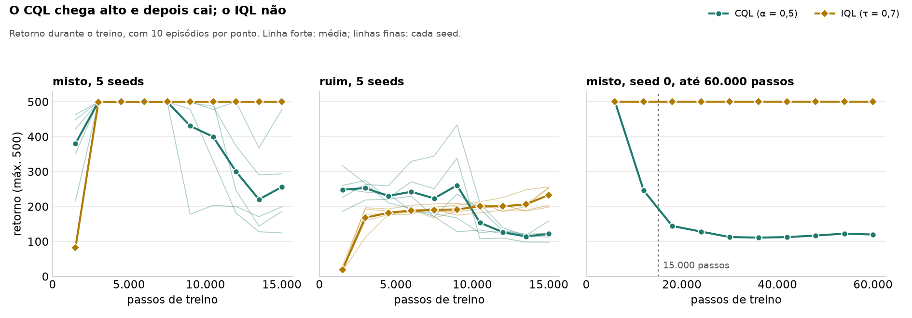
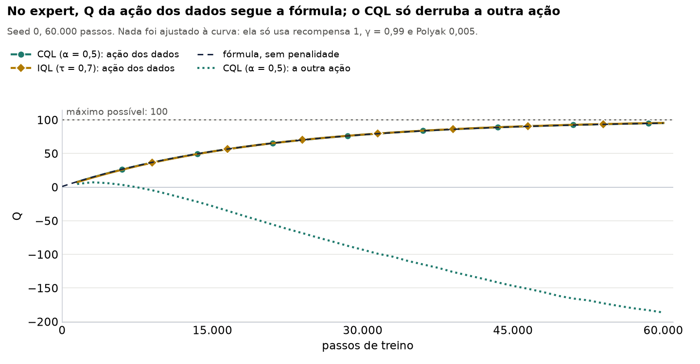
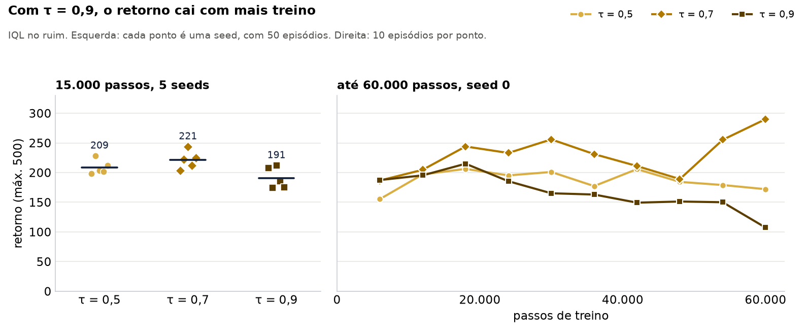
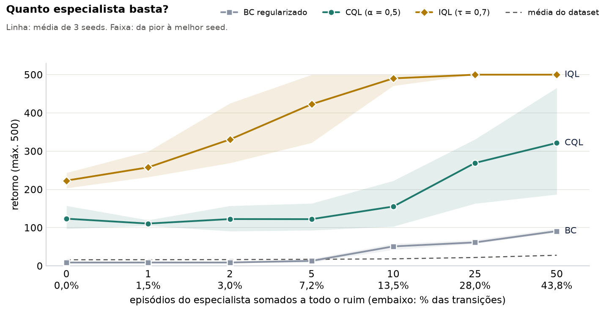
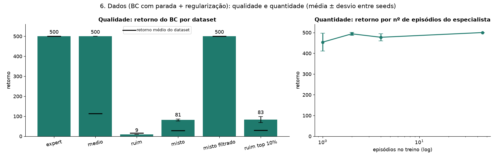

# Offline RL no CartPole: o histórico das melhorias

Registro do que mudamos no projeto, do que cada mudança fez com os números e do que aprendemos com isso. Atualizado em 2026-11-03.

**Situação:** os capítulos 1 a 9 estão concluídos. O capítulo 10 (vento) ainda não foi rodado. As mudanças de código estão no branch `melhorias-avaliacao-iql`. Todos os números vêm de `Historico/dados/` ou `Historico/analises/`, com a fonte de cada um.

## O enredo

Começamos querendo corrigir detalhes da medição. Descobrimos que os próprios números andavam sozinhos entre uma rodada e outra, e que parte do que os slides contavam não se sustenta. Então repetimos tudo com cinco seeds, para separar o que é resultado do que é sorte de uma rodada.

**O que resistiu às cinco seeds:**

- O DQN offline falha no expert em todas: retorno de 9,3 a 9,5, usando uma ação só na avaliação. O que muda muito é o tamanho de Q: o valor final vai de cerca de 300 a 460.000, contra um máximo possível de 100.
- Qualquer α > 0 no CQL conserta isso: 500 em todas as seeds.
- O dataset expert leva todos os métodos a 500. No ruim, o BC fica abaixo dos próprios dados em todas as seeds.
- No medio, no ruim e no misto, ao fim de 15.000 passos, o IQL supera o CQL em todas as seeds.

**O que caiu ou precisa mudar:**

- "O retorno cai quando τ cresce": era 212, 187 e 159 nos slides. Com uma seed, escrevemos aqui que era plano, e isso também não se sustenta. Com cinco seeds, é 209, 221 e 191: não há queda contínua, mas τ = 0,9 fica atrás de τ = 0,7 em 4 das 5 seeds e, com 60.000 passos, cai para 101 (capítulo 8).
- "O CQL fica abaixo do retorno real, o limite inferior prometido": no expert, o valor de Q reflete o tempo de treino. Aos 60.000 passos, CQL e IQL chegam a 95, como a fórmula previa (capítulos 6 e 8). No ruim, com α = 0,5, o CQL superestima: viés de +34 aos 15.000 passos e +201 aos 60.000 (capítulo 8).
- "Só o IQL volta a 500 no misto": vale ao fim de 15.000 passos, mas o CQL esteve em 500 nas cinco seeds de 3.000 a 7.500 passos, e depois caiu (capítulo 7).
- "CQL no misto: 189": uma seed só não representa esse caso. As cinco seeds vão de 123 a 466 (capítulo 7).
- "BC no ruim top 10%: 72": refeito com três seeds, dá 83, de 66 a 101. Já "misto filtrado: 500" se confirma (capítulo 9).

## A mesma medida em cinco momentos

| Medida | Slides | 1ª rodada | Rodada de 01/11 | Melhorias de 02/11 | Cinco seeds (média ± desvio) |
|---|---|---|---|---|---|
| IQL no ruim, retorno | 187 | 217 | 213 | 204 | 221 ± 15 |
| CQL no medio, retorno | 372 | 430 | 384 | 391 | 397 ± 62 |
| CQL no ruim, retorno | 126 | sem registro | 116 | 116 | 121 ± 22 |
| CQL no misto, retorno | 191 | sem registro | 189 | 187 | 260 ± 133 |
| BC no misto, retorno | 140 | 92 | 124 | 97 (regularizado) | 94 ± 15 |
| BC base no medio 10%, retorno | 385 ± 35 | 356 ± 90 | 399 ± 49 | não reexecutado | não reexecutado |
| BC no misto filtrado, retorno | 500 | sem registro | sem registro | não rodado | 500 ± 0 (3 seeds) |
| BC no ruim top 10%, retorno | 72 | sem registro | sem registro | não rodado | 83, de 66 a 101 (3 seeds) |
| DQN no expert, retorno | 9,5 | 9,3 | 9,5 | 9,5 | 9,4 ± 0,1 |
| DQN no expert, viés médio de Q | +2.737 | +19.045 | +25.667 | +25.647 | de +231 a +533.830 |
| CQL α = 0,1 no expert, viés médio | −27 | −26,7 | −26,7 | −47,1 | −47,11 ± 0,05 |
| DQN no expert, concordância com os dados | 50% | 36% | 33% | 33% | 33% numa seed, 50% nas outras |
| CQL no ruim, igual ao especialista | 73% | 66% | 65% | 65% | 71% ± 7 |
| IQL no ruim, retorno com τ = 0,5 / 0,7 / 0,9 | 212 / 187 / 159 | sem registro | 208 / 213 / 214 | 198 / 204 / 207 | 209 / 221 / 191 |

O retorno máximo é 500. A coluna "Slides" é o que as apresentações ainda mostram. A coluna "1ª rodada" vem do que o `PROJECT_GUIDE.md` registrou, porque aqueles arquivos não existem mais. A coluna "Rodada de 01/11" é o que está guardado no commit `6759143`. A coluna "Cinco seeds" usa as seeds 0 a 4; a coluna anterior é a seed 0 dela. O valor 140 do BC não bate com nenhuma figura salva. O guia supõe que veio de `--estudo dados`, mas esse estudo, refeito, dá 81 no misto. As duas linhas do BC filtrado usam o `bc_cartpole.py`, com parada antecipada.

## Capítulo 1: os números andavam sozinhos

Antes de mudarmos qualquer coisa, a mesma receita já dava números diferentes entre rodadas. Os scripts fixam as seeds, mas os resultados mudam entre máquinas e versões de bibliotecas. Com o mesmo código, seed e máquina, o resultado se repete bit a bit.

O caso mais forte é o viés do DQN: +2.737, +19.045 e +25.667. A divergência é exponencial, então o tamanho final de Q não se repete, mas a conclusão sim. O CQL no medio andou de 372 para 430 e 384.

**Depois:** o capítulo 7 mostra que, entre as duas máquinas que usamos em 02/11, os resultados foram idênticos. A máquina sozinha não explica estas diferenças.

**O que isso muda:** nenhum número de um único experimento é "o" resultado. É por isso que o capítulo 7 repete tudo com cinco seeds.

## Capítulo 2: corrigindo a régua (o G dos episódios truncados)

**O problema:** o retorno descontado `G`, usado para medir o viés de Q, começava de 0 no fim de todo episódio. Mas um episódio cortado nos 500 passos não acabou: o poste continua de pé.

**A mudança:** episódio truncado agora parte de 1/(1 − γ) = 100, o mesmo valor a que convergem os alvos de TD. A definição de `d` (só término conta como fim) continua igual.

**O efeito:** só muda a medida, nunca o treino, porque `G` só entra nas figuras e no viés.

| Viés médio | Antes | Depois |
|---|---|---|
| DQN no expert | +25.667 | +25.647 |
| CQL α = 0,1 no expert | −26,7 | −47,1 |
| CQL e IQL no ruim | +34,4 e +7,5 | iguais: nenhum episódio do ruim é truncado |

## Capítulo 3: um BC justo

**O problema:** o IQL e o CQL eram comparados com um BC sem nenhuma regularização.

**A mudança:** no `iql_cartpole.py`, o BC agora usa dropout 0,2, AdamW com weight decay 1e-3 e label smoothing 0,1. A parada antecipada continua de fora.

**O efeito:** expert e medio seguem em 500, e o ruim em 9. O misto foi de 124 para 97, mas isso não mostra que regularizar piorou: o intervalo de 95% vai de 48 a 156, porque 9 episódios chegam a 500 e 41 caem por volta do passo 10. É uma seed só de um comportamento bimodal.

## Capítulo 4: mais episódios na avaliação

**A mudança:** o `--episodios` do IQL foi de 30 para 50, igual aos outros scripts.

**O efeito:** as redes de CQL e IQL são idênticas, bit a bit, às da rodada de 01/11, e os 30 primeiros episódios também. Portanto o IQL no ruim ter ido de 213 para 204 vem só dos 20 episódios a mais. Isso dá a escala do ruído de medição com 30 episódios: cerca de 10 pontos.

O mesmo vale para a varredura de τ. Com 50 episódios, os intervalos são 183 a 214, 189 a 220 e 193 a 224.

## Capítulo 5: fora da distribuição dos dados

**A mudança:** `avaliar()` ganhou `passos_aleatorios`. Com k = 5, as cinco primeiras ações de cada episódio são sorteadas, e só depois o agente assume. Todo agente recebe os mesmos estados, e esses passos contam no retorno.

| Treinado no | Método | Padrão | Perturbado | Diferença (IC 95%) |
|---|---|---|---|---|
| expert | BC | 500,0 | 483,4 | −16,6 (−40 a −3) |
| expert | CQL α = 0,5 | 500,0 | 485,4 | −14,6 (−37 a −1) |
| expert | IQL τ = 0,7 | 500,0 | 484,5 | −15,5 (−39 a −2) |
| medio | BC | 500,0 | 488,7 | −11,3 (−32 a 0) |
| medio | CQL α = 0,5 | 390,7 | 407,6 | +16,9 (−19 a 50) |
| medio | IQL τ = 0,7 | 500,0 | 490,2 | −9,8 (−29 a 0) |
| ruim | BC | 8,9 | 12,3 | +3,5 (3 a 4) |
| ruim | CQL α = 0,5 | 116,0 | 119,4 | +3,4 (−2 a 7) |
| ruim | IQL τ = 0,7 | 203,5 | 177,6 | −25,9 (−43 a −10) |
| misto | BC | 97,3 | 32,7 | −64,7 (−123 a −15) |
| misto | CQL α = 0,5 | 187,0 | 189,6 | +2,6 (−7 a 11) |
| misto | IQL τ = 0,7 | 500,0 | 476,0 | −24,0 (−50 a −4) |

**Como ler:**

- **No expert não há diferença entre métodos.** A própria heurística que gerou os dados faz 485,4 nesse teste. A queda de cerca de 15 pontos é o custo da tarefa, não falta de robustez.
- **As quedas claras são BC no misto, IQL no ruim e IQL no misto.** A do BC é a maior.
- **O ganho do BC no ruim é um artefato:** os passos sorteados contam no retorno, e os 50 episódios continuam caindo cedo.

No geral, este teste separa pouco os métodos. Os intervalos são de uma seed só; o capítulo 7 repete o teste com cinco.

## Capítulo 6: o que estávamos lendo errado

### Q ≈ 53 no expert mede tempo de treino, não conservadorismo

Com recompensa 1, sem término e rede-alvo com Polyak 0,005, a conta fechada dá Q(t) = 1 + 0,99 × 100 × (1 − e^(−t/20.000)). Essa fórmula não tem penalidade nenhuma, e mesmo assim acerta o valor de todos os métodos:

| Passo | 3.750 | 7.500 | 11.250 | 15.000 |
|---|---|---|---|---|
| Fórmula | 17,9 | 32,0 | 43,6 | 53,2 |
| CQL α = 0,1 | 17,4 | 31,4 | 43,2 | 52,9 |
| CQL α = 5 | 17,8 | 31,8 | 43,5 | 53,2 |
| IQL τ = 0,7 (sem penalidade) | 17,2 | 31,3 | 43,2 | 53,0 |

Pela fórmula, chegar a 95 levaria cerca de 60.000 passos, e o capítulo 8 confirma isso. Portanto o viés de −47 não sustenta a frase "o limite inferior prometido". O que o α muda de verdade é o valor da outra ação, a que não está nos dados: 7,0, −28,2, −63,6 e −72,3 para α = 0,1, 0,5, 2 e 5.

### O CQL chegou a 500 no misto e perdeu

Retorno a cada 1.500 passos, com 10 episódios por ponto:

| Método e dataset | Retorno ao longo do treino |
|---|---|
| CQL no misto | 216, **500, 500, 500, 500, 500, 500**, 246, 144, 186 |
| IQL no misto | 78, 498, 500, 500, 500, 500, 500, 500, 500, 500 |
| CQL no ruim | 186, 219, 221, 230, 171, 236, 194, 130, 118, 117 |
| IQL no ruim | 16, 160, 176, 187, 187, 184, 194, 205, 187, 198 |
| BC no misto | 66, 112, 156, 107, 58, 59, 10, 10, 10, 10 |

Sem simulador, nenhum sinal do treino avisa quando parar: é um problema central de Offline RL. A causa da queda ainda não foi estabelecida. Esta tabela é de uma seed só; o capítulo 7 mostra que a queda se repete nas cinco.

### "Os pesos escolhem as transições do especialista" é só parte da história

Depois de 5 ações sorteadas, quase nada perto do agente nos dados do misto veio do especialista. Mesmo assim o IQL concorda com ele. Medido em 50 estados de passagem (o estado em que o agente assume):

| Ações sorteadas | Especialista entre os 50 vizinhos | BC concorda | CQL concorda | IQL concorda |
|---|---|---|---|---|
| 0 | 8% | 24% | 46% | 88% |
| 5 | 0% | 14% | 54% | 98% |

Esta medida é de uma seed só. Além disso, o IQL já concorda de 86% a 89% no ruim, nas cinco seeds, e o ruim não tem nenhum episódio do especialista. Esta é uma explicação plausível, ainda não comprovada.

## Um desvio: a GPU ajuda?

Antes da rodada grande, medimos o mesmo trabalho na CPU e na GPU de uma mesma máquina: os 14 modelos do `iql_cartpole.py`, com 2.000 passos e 5 episódios de avaliação.

| Dispositivo | Processos | Tempo total |
|---|---|---|
| CPU | 8 | 38,5 s |
| GPU | 8 | 47,5 s |
| GPU | 4 | 54,7 s |
| CPU | 4 | 55,3 a 56,7 s (três repetições) |

Com 4 processos, houve empate. Com 8, a CPU foi 9 s mais rápida. Foi também a primeira execução real do `--device cuda`, e ela chegou ao fim nos dois casos.

Este teste é curto e inclui a inicialização da GPU, que só acontece uma vez, então a diferença pode diminuir em treinos longos. Mesmo assim, nada aqui indica ganho com a GPU. Por isso, a rodada grande usou a CPU, com 8 processos, e levou cerca de 40 minutos. Na GPU, 4 e 8 processos deram pesos idênticos entre si e diferentes dos da CPU, como esperado.

Por que isso faz sentido? As redes são pequenas (cerca de 67 mil parâmetros, lotes de 256). Num passo sintético do IQL contamos de 396 a 537 operações com tensores, cada uma levando em média de 20 a 26 µs numa thread de CPU, em outra máquina. A explicação mais provável, que não medimos na GPU, é que operações tão pequenas não compensam o custo fixo de disparar cada uma na GPU. Com 8 processos há ainda uma disputa: eles dividem uma GPU, enquanto na CPU cada um tem seu núcleo. A GPU também não liberou o processador: com 8 processos, o tempo de CPU foi de 3 min 20 s sem ela para 4 min 51 s com ela. E o código não foi ajustado para GPU: o IQL chama `.item()` quatro vezes por passo, e cada chamada faz a CPU esperar a GPU. Os dados não são o gargalo: eles ficam na GPU, e a cada passo só viajam os 256 índices do lote. A saída original está em `Historico/analises/teste_velocidade_20261102.txt`, e a contagem, em `Historico/analises/conta_ops_20261102.txt`.

## Capítulo 7: cinco seeds

**A pergunta:** o que continua de pé quando a seed muda? As seeds variam a inicialização e os lotes; os dados e os episódios de avaliação ficam fixos. Cada modelo é avaliado em 50 episódios.


| Retorno (média ± desvio entre seeds) | expert | medio | ruim | misto |
|---|---|---|---|---|
| Média do dataset | 500 | 113 | 16 | 27,8 |
| BC regularizado | 500 ± 0 | 500 ± 0 | 8,9 ± 0,0 | 93,6 ± 14,8 |
| CQL α = 0,5 | 500 ± 0 | 397,1 ± 62,4 | 120,8 ± 22,4 | 260,2 ± 133,4 |
| IQL τ = 0,7 | 500 ± 0 | 500 ± 0 | 221,2 ± 15,1 | 500 ± 0 |

**O que se repete em todas as seeds:**

- O IQL supera o CQL no medio, no ruim e no misto.
- O BC faz 500 no medio e fica abaixo dos dados no ruim.
- Qualquer α > 0 faz 500 no expert, e o DQN offline (α = 0) falha.
- Nos episódios de avaliação, o DQN usa uma ação só: sempre à esquerda dá retorno 9,26 (3 seeds), sempre à direita dá 9,50 (2 seeds).

**O que a seed muda:**

- **O tamanho de Q no DQN.** O Q final nos dados vai de 295 a 443.144, e o viés, de +231 a +533.830. "Q da ordem de 10⁴" era o que uma seed deu. O que se sustenta é que o retorno não depende desse tamanho. Já o CQL com α = 0,1 termina com Q entre 52,8 e 52,9 em todas as seeds.
- **O CQL no misto:** de 123 a 466. O 187 da seed 0 estava na parte baixa da faixa.
- **O CQL no medio:** de 306 a 478. Os 372, 430 e 384 de antes cabem nessa faixa.

### A queda do CQL se repete



No misto, as cinco seeds estão em 500 em todos os pontos de 3.000 a 7.500 passos, e todas terminam abaixo disso. A média cai de 500 para 256. No ruim, a queda vem depois dos 9.000 passos: a média vai de 261 para 122, e nas cinco seeds o último ponto fica abaixo do primeiro. Na média, o IQL não cai em nenhum dos dois.

| CQL no misto, média das 5 seeds | 7.500 | 9.000 | 10.500 | 12.000 | 13.500 | 15.000 |
|---|---|---|---|---|---|---|
| Retorno | 500 | 431 | 400 | 300 | 220 | 256 |
| Q nos dados | 28,9 | 33,7 | 38,3 | 42,3 | 46,1 | 49,9 |
| Q na outra ação | 28,8 | 33,7 | 38,3 | 42,3 | 46,2 | 50,0 |
| Concordância com os dados | 59% | 57% | 59% | 58% | 58% | 58% |
| Perda de TD | 0,52 | 0,68 | 0,74 | 0,77 | 0,91 | 0,94 |

Nada nesses sinais marca o momento da queda: Q e a perda de TD sobem sem salto desde o começo do treino. Com um simulador, pararíamos aos 7.500 passos com retorno 500. Sem ele, nenhum destes números avisaria. A causa da queda continua não estabelecida, e tudo isto vale para α = 0,5, que não foi ajustado por dataset.

### O teste perturbado com cinco seeds

As três quedas claras do capítulo 5 se repetem nas cinco seeds: BC no misto (93,6 para 30,5), IQL no ruim (221,2 para 194,3) e IQL no misto (500 para 477,3). O CQL no misto não muda na média (260,2 para 259,8). No medio, o IQL dá 490,2 em todas as seeds porque 49 episódios chegam a 500 e um deles, sempre o mesmo, acaba no passo 10.

### Duas máquinas, o mesmo resultado

A seed 0 rodou em duas máquinas diferentes, com o mesmo código: os 14 modelos saíram idênticos, pesos inclusive, e as 28 listas de retornos também. Portanto, a máquina sozinha não explica as diferenças do capítulo 1. Os arquivos antigos não registram versões de bibliotecas, então não sabemos o que explica.

## Capítulo 8: 60.000 passos

**As perguntas:** a queda do CQL persiste com mais treino? Q realmente chega perto de 100, como a fórmula prevê? Estas rodadas são de uma seed só (a seed 0): primeiro no ruim e no misto, depois no expert, para testar a fórmula.

| Modelo | 15.000 passos | 60.000 passos |
|---|---|---|
| IQL τ = 0,7 no misto | 500,0 | 500,0 |
| IQL τ = 0,7 no ruim | 203,5 | 246,7 |
| CQL α = 0,5 no misto | 187,0 | 118,5 |
| CQL α = 0,5 no ruim | 116,0 | 95,1 |
| BC no misto | 97,3 | 87,7 |
| BC no ruim | 8,9 | 8,9 |

**A queda persiste.** O CQL não se recupera: de 30.000 a 60.000 passos, ele fica entre 111 e 123 no misto. Mais treino também muda pouco os outros: o ganho do IQL no ruim, de 203,5 para 246,7, é pequeno perto do que a seed já faz com 15.000 passos (de 204 a 244).

**O viés do CQL cresce; o do IQL, não.** No ruim, aos 60.000 passos, o Q do CQL nos dados é 216, acima do máximo possível de 100:

| Viés de Q nos dados do ruim | 15.000 passos | 60.000 passos |
|---|---|---|
| CQL α = 0,5 | +34,4 | +201,4 |
| IQL τ = 0,7 | +7,5 | +7,6 |

O alvo do IQL não usa máximo sobre as ações, e o do CQL usa. Além disso, no ruim as duas ações aparecem nos dados, e seus valores de Q ficam quase iguais. Esta é uma explicação plausível, não testada.

**Q perto de 100? No expert, sim, e a fórmula acerta.** Aos 60.000 passos, CQL e IQL estão a menos de 5 do valor verdadeiro, que é 100, e seguem a fórmula do capítulo 6 o tempo todo:



| No expert, seed 0 | 7.500 | 15.000 | 30.000 | 45.000 | 60.000 |
|---|---|---|---|---|---|
| Fórmula | 32,0 | 53,2 | 77,9 | 89,6 | 95,1 |
| CQL α = 0,5, ação dos dados | 31,7 | 53,0 | 78,0 | 89,8 | 95,4 |
| IQL τ = 0,7, ação dos dados | 31,3 | 53,0 | 78,1 | 89,9 | 95,5 |
| CQL α = 0,5, outra ação | −0,3 | −28,2 | −93,0 | −146,8 | −186,4 |

Isso confirma o capítulo 6: no expert, o Q da ação dos dados mede o tempo de treino, com ou sem penalidade. O que o CQL muda é a outra ação, que segue caindo. O retorno fica em 500 em todos os pontos, nos dois métodos. Os modelos do ruim, retreinados nesta rodada, saíram idênticos aos da anterior, pesos inclusive.

**Com dados misturados, a história é outra.** Nos estados do especialista dentro do misto, medidos com os pesos salvos:

| Q da ação do especialista, no misto | 15.000 passos | 60.000 passos |
|---|---|---|
| Fórmula (vale para o expert sozinho) | 53,2 | 95,1 |
| CQL α = 0,5 | 57,1 | 171,7 |
| IQL τ = 0,7 | 46,1 | 80,9 |

O IQL cresce e fica abaixo da fórmula; o CQL passa bem do máximo. Nesses mesmos estados, a concordância com o especialista anda em sentidos opostos: de 71% para 57% no CQL e de 90% para 93% no IQL.

### τ: nem queda contínua, nem plano



| IQL no ruim | τ = 0,5 | τ = 0,7 | τ = 0,9 |
|---|---|---|---|
| Retorno nos slides | 212 | 187 | 159 |
| Retorno, 15.000 passos, cinco seeds | 208,5 ± 12,0 | 221,2 ± 15,1 | 190,9 ± 17,7 |
| Retorno, 60.000 passos, seed 0 | 225,8 | 246,7 | 101,0 |
| V, 15.000 passos, média de cinco seeds | 8,8 | 17,7 | 43,7 |
| V, 60.000 passos, seed 0 | 8,8 | 17,8 | 88,2 |

Com cinco seeds, τ = 0,7 fica acima de τ = 0,9 em 4 seeds e acima de τ = 0,5 em 4, embora as faixas se sobreponham. A queda contínua dos slides não aparece. Os 60.000 passos acrescentam outra coisa: com τ = 0,9, V segue subindo e o retorno cai, enquanto com τ = 0,5 e 0,7 o V já parou. O "otimismo demais" dos slides tem sustentação, mas aparece em τ = 0,9 e com mais treino. A parte longa é de uma seed só.

## Capítulo 9: quanto especialista basta?

**A pergunta:** o misto tem 2,4% de episódios do especialista, mas 43,8% das transições. Ele é fácil demais? A varredura treina BC, CQL e IQL em todo o ruim mais k episódios do especialista, com três seeds.



| Episódios do especialista | 0 | 1 | 2 | 5 | 10 | 25 | 50 |
|---|---|---|---|---|---|---|---|
| % das transições | 0% | 1,5% | 3,0% | 7,2% | 13,5% | 28,0% | 43,8% |
| % dos episódios | 0% | 0,05% | 0,10% | 0,25% | 0,50% | 1,2% | 2,4% |
| BC, média | 8,9 | 8,9 | 8,9 | 13,1 | 51,0 | 61,4 | 91,0 |
| CQL, média | 123 | 111 | 122 | 122 | 155 | 269 | 321 |
| CQL, pior e melhor seed | 97 a 157 | 105 a 120 | 91 a 157 | 93 a 163 | 103 a 223 | 163 a 331 | 187 a 466 |
| IQL, média | 223 | 258 | 331 | 423 | 490 | 500 | 500 |
| IQL, pior e melhor seed | 204 a 244 | 232 a 299 | 269 a 425 | 322 a 500 | 471 a 500 | 500 | 500 |

k = 0 é o ruim e k = 50 é o misto. Conferimos que o código monta exatamente esses dois datasets, array por array. Eles usam as seeds 0, 1 e 2, por isso as médias aqui diferem um pouco das de cinco seeds do capítulo 7. Nos outros níveis, a seed também sorteia quais episódios entram.

**A resposta: para o IQL, o misto é fácil demais.** Com 25 episódios ele já faz 500 nas três seeds, e com 10 (0,5% dos episódios, 13,5% das transições) faz 490. A diferença entre os métodos fica mais visível por volta de k = 5: IQL 423, CQL 122, BC 13.

- **CQL:** não sai do patamar do ruim até k = 5 e só sobe de verdade em k = 25, com muita variação entre seeds.
- **BC:** sobe a partir de k = 10 e chega só a cerca de 90 com 50 episódios. Esse ganho é frágil: com as ações iniciais sorteadas do capítulo 5, o BC faz cerca de 12 em k = 10.

### E se só houvesse os dados bons?

O `bc_cartpole.py --estudo dados` treina o BC, com parada antecipada e regularização, em partes dos dados. São três seeds, que aqui também mudam os episódios escolhidos:



| Dados do BC | Episódios de treino | Média do dataset | Retorno do BC | Pior e melhor seed |
|---|---|---|---|---|
| ruim | 1.800 | 16,0 | 8,9 | 8,9 |
| misto | 1.845 | 27,8 | 81,2 | 77,8 a 87,7 |
| misto filtrado (só episódios que chegam a 500) | 45 | 500 | 500 | 500 |
| ruim top 10% | 197 | 29,8 | 83,3 | 65,5 a 101,4 |
| 1 episódio do especialista | 1 | 500 | 453,8 | 396,4 a 500 |
| 2 episódios do especialista | 2 | 500 | 493,9 | 483,9 a 500 |
| 4 episódios do especialista | 4 | 500 | 477,2 | 459,8 a 500 |
| 45 episódios do especialista | 45 | 500 | 500 | 500 |

**Para o BC, o problema não é falta de dados bons: é a mistura.** Um único episódio do especialista, sozinho, dá 454. Esse mesmo tipo de episódio somado a todo o ruim dá 8,9 (k = 1 na tabela anterior). A varredura usa o BC sem parada antecipada, mas isso não explica o salto: no ruim e no misto, as duas variantes ficam próximas (8,9 e 8,9; 91 e 81).

**Filtrar resolve, mas alguém precisa filtrar.** No misto, manter só os episódios que chegam a 500 devolve exatamente o expert, e o BC volta a 500. Esse filtro usa o retorno, que o BC sozinho não lê. O IQL faz uma separação parecida sem filtro nenhum: no misto, ele chega a 500 com todos os dados juntos. Já o top 10% do ruim ajuda menos, porque até os melhores episódios ali são ruidosos: o BC faz 83, acima dos 29,8 dos dados selecionados.

## Capítulo 10: vento (pendente)

**A pergunta:** e se o mundo mudar depois da coleta? As políticas prontas são avaliadas com vento, sem retreino. Nenhum destes métodos trata mudança de dinâmica, então todos podem cair juntos: é um tema para limites e trabalhos futuros.

Por enquanto só temos a referência, a heurística que gerou os dados. O vento constante a tira do trilho, e as rajadas fortes derrubam o poste:

| Vento | Retorno da heurística |
|---|---|
| Constante, 0 e 2 N | 500 |
| Constante, 3 / 4 / 5 N | 445 / 351 / 252 |
| Rajadas, σ = 5 / 10 / 15 N | 500 / 456,5 / 137,5 |

Conferimos o script: com vento zero, ele reproduz exatamente os 50 retornos salvos dos 12 modelos da seed 0.

## O que mudou no código

| Arquivo | Mudança | Muda o treino? |
|---|---|---|
| `Código/*/cartpole_comum.py` (3 cópias) | `G` de episódio truncado parte de 100 | Não |
| `Código/*/cartpole_comum.py` | `avaliar(..., passos_aleatorios=0)` | Não |
| `Código/IQL/iql_cartpole.py` | BC regularizado | Só o do BC |
| `Código/IQL/iql_cartpole.py` | `--episodios` de 30 para 50 | Não |
| `Código/IQL/iql_cartpole.py` | teste perturbado em `numeros.json` e `5_resultado.png` | Não |
| `Código/CQL/cql_cartpole.py` | rótulo do eixo da figura 1 | Não |
| Scripts de treino e `Código/*/cartpole_comum.py` | `--device` (padrão `cpu`), para treinar também em `cuda`; a avaliação fica sempre na CPU | Na CPU, não: resultados idênticos bit a bit |
| `.gitignore` | ignora `experimentos/` e `CLAUDE.md` | Não |
| `Código/Extras/` (novo) | varredura, vento, coleta e figuras deste histórico | Não: só importa os scripts principais |

Não mudaram: `Código/videos_cartpole.py`, a definição de `d`, as seeds fixas e as pastas `figuras_*`. No `Código/BC/bc_cartpole.py`, só entrou o `--device`. Os `.pt` antigos continuam carregando, e os pesos são sempre salvos na CPU. Resultados treinados na GPU não são idênticos aos da CPU: todas as seeds de uma comparação devem usar o mesmo dispositivo.

## Os dados, para gerar gráficos depois

Tudo fica em `Historico/dados/`. Nada precisa ser retreinado.

| Arquivo | O que tem | Serve para |
|---|---|---|
| `marcos.csv` | cada marco, data, fonte e situação | a linha do tempo |
| `comparacao_marcos.csv` | cada métrica com uma coluna por marco | a tabela "a mesma medida em cinco momentos" |
| `evolucao.csv` | formato longo: marco, seed, método, dataset, métrica, valor, fonte | qualquer gráfico de antes e depois |
| `curvas.csv` | o log de treino de cada modelo por passo: retorno, Q, V, concordância | a subida e queda do CQL, Q contra a fórmula |
| `episodios.csv` | o retorno de cada episódio avaliado | distribuições e intervalos próprios |
| `ic95.csv` | média e IC 95% de cada modelo, padrão e perturbado | barras de erro |
| `resumo_seeds.csv` | média, desvio, mínimo e máximo entre seeds | a figura das cinco seeds |
| `varredura.csv`, `varredura_curvas.csv` | cada nível k por seed e método: retorno, perturbado e curva de treino | a figura da varredura |
| `manifesto.csv` | arquivo, tamanho e md5 de cada fonte | rastrear de onde veio cada número |

`Historico/snapshots/` guarda os `numeros.json`, os PNGs e os logs de cada marco. `Historico/analises/` guarda os scripts e as saídas das análises dos capítulos 6 a 8. `Historico/figuras/` guarda as figuras deste texto, feitas só a partir desses CSVs.

**Nada antigo é apagado:** os resultados do commit `6759143` são lidos direto do git, então promover um run para `figuras_*` não muda este histórico. Se um arquivo de snapshot muda, a versão nova entra ao lado, com o hash no nome. Os pesos em `experimentos/` não vão para o git: faça uma cópia se quiser guardá-los.

Para atualizar depois de novos experimentos, sem treinar nada:

```
python Código/Extras/coletar_historico.py
python Código/Extras/figuras_historico.py
```
