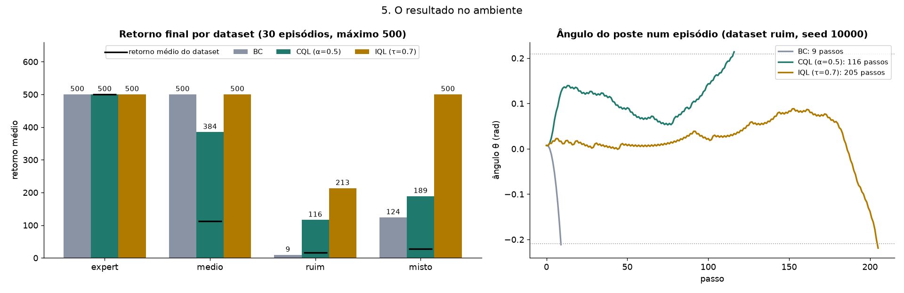

# Offline RL on CartPole: BC, CQL and IQL

Final project for the Deep Reinforcement Learning course (Master's, 2nd semester).

We train agents for **CartPole-v1** without letting them touch the environment during training. Each agent only reads a fixed dataset of transitions `(s, a, r, s', d)` recorded by a noisy heuristic policy. The environment is used once, at the end, to measure the return.

We compare three offline methods on four datasets of different quality:

| Method | Core idea | Uses reward? |
|---|---|---|
| **BC** (Behavior Cloning) | Supervised classification: copy the dataset's action | No |
| **CQL** (Conservative Q-Learning) | Q-learning plus a penalty that pushes down Q of actions not in the data | Yes |
| **IQL** (Implicit Q-Learning) | Never queries Q of unseen actions: expectile value + advantage-weighted BC | Yes |

> The code, figures and slides are in Portuguese. See the glossary in [`PROJECT_GUIDE.md`](PROJECT_GUIDE.md#12-glossary-pt--en).

## Datasets

All datasets come from a one-line expert heuristic, `push right if θ + 0.5ω + 0.01x + 0.1v > 0`, which scores 500/500 on its own. Each action is flipped with probability *p*:

| Dataset | Flip *p* | Episodes | Transitions | Avg. return |
|---|---|---|---|---|
| `expert` | 0% | 50 | 25,000 | 500.0 |
| `medio` (medium) | 30% | 300 | 33,895 | 113.0 |
| `ruim` (bad) | 60% | 2,000 | 32,074 | 16.0 |
| `misto` (mixed) = expert + ruim | – | 2,050 | 57,074 | 27.8 |

At 30% noise the correct action is still the majority in each state, so copying works. At 60% the wrong action is the majority, so only methods that read the reward can beat the data.

The datasets are generated with [Minari](https://minari.farama.org/) on the first run and cached in `~/.minari/datasets/cartpole/`. `misto` is built in memory.

## Results

Return on CartPole-v1 (max 500), seed 0, 30 evaluation episodes per model. Source: `figuras_iql_cartpole/numeros.json`.

| Dataset | Data | BC | CQL (α = 0.5) | IQL (τ = 0.7) |
|---|---|---|---|---|
| `expert` | 500.0 | 500.0 | 500.0 | 500.0 |
| `medio` | 113.0 | 500.0 | 384.5 | 500.0 |
| `ruim` | 16.0 | 9.0 | 115.9 | **213.0** |
| `misto` | 27.8 | 123.6 | 188.6 | **500.0** |



Other findings:

- **Offline DQN diverges.** On `expert`, each state shows only one action, so the other action's Q is never corrected. Offline Double DQN (CQL with α = 0) ends with Q values around 2.5 × 10⁴, while the true return-to-go is at most 100. It scores 9.5. CQL with any α ≥ 0.1 stays below the real return (bias −26.7) and scores 500. See `figuras_cql_cartpole/`.
- **BC needs early stopping on scarce, noisy data.** With 10% of `medio` (27 episodes), BC trained to the last step scores 399 ± 49 over 3 seeds, because it memorizes the noise. Early stopping alone brings it to 500 ± 0. Regularization and history stacking add nothing on top, as expected for a fully observable task. See `figuras_bc_cartpole/`.

## Project layout

```
.
├── Código/                     # code
│   ├── BC/bc_cartpole.py       # Behavior Cloning + early stopping / regularization / memory variants
│   ├── CQL/cql_cartpole.py     # offline DQN (α = 0) vs CQL, α sweep
│   ├── IQL/iql_cartpole.py     # IQL vs CQL vs BC on the 4 datasets, τ sweep
│   ├── */cartpole_comum.py     # shared module (3 identical copies, keep them in sync)
│   └── videos_cartpole.py      # side-by-side videos of the trained agents
├── figuras_{bc,cql,iql}_cartpole/   # figures, numeros.json (key metrics) and trained weights (.pt)
├── videos_cartpole/            # MP4/GIF episodes for the slides
├── Output/                     # re-run results and logs (see PROJECT_GUIDE.md §9)
├── Apresentações/              # slide decks (.pptx)
└── PROJECT_GUIDE.md            # full walkthrough of the code, math and results
```

## Setup

Python 3.12+. No GPU needed: everything runs on CPU, one thread per process, with parallelism across processes.

```bash
python -m venv .venv
source .venv/bin/activate
pip install torch gymnasium matplotlib "minari[create,hdf5]"
```

The script docstrings say `minari[create]`. With Minari 0.5.x that fails with `ImportError: h5py is not installed`, so include the `hdf5` extra.

For the videos, also install:

```bash
pip install "gymnasium[classic-control]" imageio imageio-ffmpeg
```

## Usage

Run from the project root. Outputs go to `./figuras_<method>_cartpole/` relative to the current directory.

```bash
python Código/BC/bc_cartpole.py      # BC: 4 variants × 3 seeds on medio 10%      (~6 min on 8 cores)
python Código/CQL/cql_cartpole.py    # CQL: α ∈ {0, 0.1, 0.5, 2, 5} on expert     (~8 min)
python Código/IQL/iql_cartpole.py    # IQL vs CQL vs BC on 4 datasets + τ sweep   (~20–25 min)
python Código/videos_cartpole.py     # MP4s from the saved models (add --gif for GIFs)
```

Re-plot from the saved weights without retraining (seconds):

```bash
python Código/BC/bc_cartpole.py --so-graficos
```

Common flags, available on all three training scripts:

| Flag | Meaning |
|---|---|
| `--so-graficos` | Skip training, re-plot from the saved `.pt` |
| `--pasta DIR` | Output folder |
| `--workers N` | Number of parallel processes |
| `--passos N` | Training steps |
| `--mostrar` | Also open the figures in a window |

Quick runs: `python Código/BC/bc_cartpole.py --seeds 0 --passos 5000` and `python Código/IQL/iql_cartpole.py --datasets ruim misto`. Run any script with `--help` for the rest, or see [`PROJECT_GUIDE.md` §3](PROJECT_GUIDE.md#3-how-to-run).

## Limitations

- CQL and IQL results use a single seed, so they have no error bars. BC uses 3 seeds.
- The BC inside `iql_cartpole.py` is plain BC (no early stopping), unlike the improved variants in `bc_cartpole.py`.
- CartPole is fully observable and has only 2 actions, so it cannot show the benefit of memory or the behaviour of these methods on large action spaces.

## References

- S. Levine, A. Kumar, G. Tucker, J. Fu. *Offline Reinforcement Learning: Tutorial, Review, and Perspectives on Open Problems.* 2020. [arXiv:2005.01643](https://arxiv.org/abs/2005.01643)
- A. Kumar, A. Zhou, G. Tucker, S. Levine. *Conservative Q-Learning for Offline Reinforcement Learning.* NeurIPS 2020. [arXiv:2006.04779](https://arxiv.org/abs/2006.04779)
- I. Kostrikov, A. Nair, S. Levine. *Offline Reinforcement Learning with Implicit Q-Learning.* ICLR 2022. [arXiv:2110.06169](https://arxiv.org/abs/2110.06169)
- [Gymnasium](https://gymnasium.farama.org/) and [Minari](https://minari.farama.org/), Farama Foundation.
