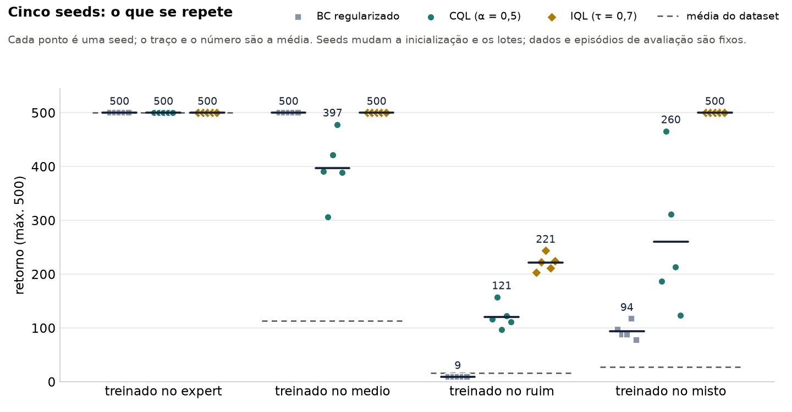

# Offline RL on CartPole: BC, CQL and IQL

Final project for the Deep Reinforcement Learning course (Master's, 2nd semester).

We train agents for **CartPole-v1** without letting them touch the environment during training. Each agent only reads a fixed dataset of transitions `(s, a, r, s', d)` recorded by a noisy heuristic policy. The environment is used once, at the end, to measure the return.

We compare three offline methods on four datasets of different quality:

| Method | Core idea | Uses reward? |
|---|---|---|
| **BC** (Behavior Cloning) | Supervised classification: copy the dataset's action | No |
| **CQL** (Conservative Q-Learning) | Q-learning plus a penalty that pushes down Q of actions not in the data | Yes |
| **IQL** (Implicit Q-Learning) | Never queries Q of unseen actions: expectile value + advantage-weighted BC | Yes |

> The code, figures, slides and the run record in `Historico/` are in Portuguese. See the glossary in [`PROJECT_GUIDE.md`](PROJECT_GUIDE.md#12-glossary-pt--en).

## Datasets

All datasets come from a one-line expert heuristic, `push right if θ + 0.5ω + 0.01x + 0.1v > 0`, which scores 500/500 on its own. Each action is flipped with probability *p*:

| Dataset | Flip *p* | Episodes | Transitions | Avg. return |
|---|---|---|---|---|
| `expert` | 0% | 50 | 25,000 | 500.0 |
| `medio` (medium) | 30% | 300 | 33,895 | 113.0 |
| `ruim` (bad) | 60% | 2,000 | 32,074 | 16.0 |
| `misto` (mixed) = expert + ruim | – | 2,050 | 57,074 | 27.8 |

At 30% noise the correct action is still the majority in each state, so copying works. At 60% the wrong action is the majority, so only methods that read the reward can beat the data.

The datasets are generated with [Minari](https://minari.farama.org/) on the first run and cached in `~/.minari/datasets/cartpole/`. `misto` is built in memory.

## How we evaluate

- **Metric:** return in the CartPole-v1 simulator (max 500), measured only after training ends.
- **Episodes:** 50 evaluation episodes per model, starting from seeds `10000 + k`. The dataset episodes use seeds `100000 + episode`, so evaluation never starts from a training episode.
- **Training seeds:** 5 for CQL and IQL (0–4). The seed changes the initialization and the minibatches; the data and the evaluation episodes stay fixed. BC in `bc_cartpole.py` uses 3 seeds, which also pick its training subset.
- **Training:** 15,000 gradient steps (BC in `bc_cartpole.py`: up to 20,000, with early stopping). MLP 4→256→256→out, batch 256, γ = 0.99.
- **Perturbed test:** the first 5 actions of each episode are random, then the agent takes over. Every agent gets the same states, and those steps count in the return.

## Results

Return on CartPole-v1, mean ± standard deviation over 5 seeds, 15,000 steps. Source: [`Historico/dados/resumo_seeds.csv`](Historico/dados/resumo_seeds.csv).

| Dataset | Data | BC (regularized) | CQL (α = 0.5) | IQL (τ = 0.7) |
|---|---|---|---|---|
| `expert` | 500.0 | 500 ± 0 | 500 ± 0 | 500 ± 0 |
| `medio` | 113.0 | 500 ± 0 | 397.1 ± 62.4 | 500 ± 0 |
| `ruim` | 16.0 | 8.9 ± 0.0 | 120.8 ± 22.4 | **221.2 ± 15.1** |
| `misto` | 27.8 | 93.6 ± 14.8 | 260.2 ± 133.4 | **500 ± 0** |



IQL beats CQL (α = 0.5) on `medio`, `ruim` and `misto` in every seed. On `ruim`, BC falls below its own data in every seed.

**What held up after all the follow-up runs:** IQL keeps what it learns. CQL can match it, but only with the right α and the right moment to stop, and offline data can check neither.

### Findings

- **Offline DQN diverges on `expert`.** Each state shows only one action, so the other action's Q is never corrected. Offline Double DQN (CQL with α = 0) scores 9.3–9.5 in all five seeds and uses a single action in every evaluation episode. How large Q gets depends on the seed: the final Q on the data ranges from 295 to 443,144, against a true maximum of 100. Any α > 0 scores 500 in every seed. See `figuras_cql_cartpole/`.
- **CQL's result hinges on α.** With α = 5 (GPU runs, 5 seeds, 15,000 steps), CQL ties IQL on `medio` and `misto` (500 ± 0) and gets close on `ruim` (192 ± 20 against 220 ± 12). Too much penalty turns CQL into BC: at α = 50 on `ruim` it scores 8.9, the same as BC. Choosing α from the data alone, by the lowest Q bias, picks the wrong α on `ruim` and `misto`.
- **CQL rises and then falls; IQL does not.** On `misto` with α = 0.5, all five seeds are at 500 from 3,000 to 7,500 steps, and the mean then drops to 256 by step 15,000. Q and the TD loss rise smoothly through the drop, so no training signal says when to stop. A stronger α only delays the fall: at 60,000 steps, CQL with α = 5 scores 266 ± 164 on `misto` and 90 ± 15 on `ruim`, against IQL's 500 ± 0 and 244 ± 124. The cause of the fall is not isolated.
- **IQL depends little on its own settings.** On `misto` it scores 500 in every seed for every τ (0.5, 0.7, 0.9) and β (0.3, 1, 3) tested. On `ruim`, τ = 0.5 / 0.7 / 0.9 give 209 / 221 / 191, and β = 0.3 drops to 153.
- **How much expert data is enough?** We added k expert episodes to all of `ruim` (3 seeds). IQL reaches 490 with k = 10 (0.5% of the episodes) and 500 with k = 25. At k = 25, CQL (α = 0.5) scores 269 and BC 61.
- **For BC, the problem is the mixture, not a lack of good data.** One expert episode on its own gives BC 454. The same kind of episode added to all of `ruim` gives 8.9. Keeping only the `misto` episodes that reach 500 brings BC back to 500, but that filter uses the return, which BC itself never reads.
- **BC needs early stopping on scarce, noisy data.** With 10% of `medio` (27 episodes), BC trained to the last step scores 399 ± 49 over 3 seeds, because it memorizes the noise. Early stopping alone brings it to 500 ± 0. Regularization and history stacking add nothing on top, as expected for a fully observable task. See `figuras_bc_cartpole/`.
- **On `expert`, CQL's Q ≈ 53 measures training time, not conservatism.** With reward 1, no terminations and a Polyak target (0.005), Q(t) = 1 + 0.99 × 100 × (1 − e^(−t/20,000)). This formula has no penalty term, yet it predicts the Q of CQL and IQL alike; both reach about 95 at 60,000 steps. What α changes is the Q of the action that is not in the data.

### Earlier numbers

The figures in `figuras_*/`, and the slides, come from an earlier single-seed run (seed 0, saved in commit `6759143`). That run predates the measurement fixes and the regularized BC, and evaluated IQL on 30 episodes. Where it disagrees with the table above, the five-seed numbers win.

Older results are never deleted. [`Historico/HISTORIA.md`](Historico/HISTORIA.md) records every run in order, chapter by chapter (in pt-BR), with each number tracked from the slides to the five-seed runs. It is also rendered as `Historico/historia.html` and summarized in `Historico/resumo_1pagina.pdf` and `Historico/resumo_3paginas.pdf`.

## Project layout

```
.
├── Código/                     # code
│   ├── BC/bc_cartpole.py       # Behavior Cloning + early stopping / regularization / memory variants
│   ├── CQL/cql_cartpole.py     # offline DQN (α = 0) vs CQL, α sweep
│   ├── IQL/iql_cartpole.py     # IQL vs CQL vs BC on the 4 datasets, τ sweep, perturbed test
│   ├── */cartpole_comum.py     # shared module (3 identical copies, keep them in sync)
│   ├── videos_cartpole.py      # side-by-side videos of the trained agents
│   └── Extras/                 # follow-up studies and the run record (they import the main scripts)
├── figuras_{bc,cql,iql}_cartpole/   # figures, numeros.json and weights (.pt) of the run in the slides
├── Historico/                  # record of every run
│   ├── HISTORIA.md             # the story, chapter by chapter (also historia.html and the PDFs)
│   ├── dados/                  # every measured value, per seed, as CSV
│   ├── figuras/                # figures drawn from those CSVs
│   ├── snapshots/              # numeros.json, PNGs and logs of each milestone
│   └── analises/               # one-off analysis scripts and their output
├── videos_cartpole/            # MP4/GIF episodes for the slides
├── Output/                     # 2026-11-01 re-run results and logs
├── Apresentações/              # slide decks (.pptx)
└── PROJECT_GUIDE.md            # full walkthrough of the code, math and results
```

New runs go in `experimentos/`, which is gitignored: the raw runs and their weights stay on the machine that ran them.

## Setup

Python 3.12+.

```bash
python -m venv .venv
source .venv/bin/activate
pip install torch gymnasium matplotlib "minari[create,hdf5]"
```

The script docstrings say `minari[create]`. With Minari 0.5.x that fails with `ImportError: h5py is not installed`, so include the `hdf5` extra.

For the videos, also install:

```bash
pip install "gymnasium[classic-control]" imageio imageio-ffmpeg
```

**No GPU needed.** Training runs on CPU by default, one thread per process and one process per model. `--device cuda` trains on the GPU (evaluation always stays on the CPU), but in our test the CPU was faster: 38.5 s against 47.5 s for the same job with 8 processes. The networks are small (about 67k parameters, batches of 256), so the fixed cost of launching each GPU operation most likely dominates (not measured). GPU weights are not bit-identical to CPU weights, so keep every seed of a comparison on the same device.

## Usage

Run from the project root.

```bash
python Código/BC/bc_cartpole.py      # BC: 4 variants × 3 seeds on medio 10%
python Código/CQL/cql_cartpole.py    # CQL: α ∈ {0, 0.1, 0.5, 2, 5} on expert
python Código/IQL/iql_cartpole.py    # IQL vs CQL vs BC on 4 datasets + τ sweep
python Código/videos_cartpole.py     # MP4s from the saved models (add --gif)
```

With `--workers 8` on an 8-core desktop CPU, the default jobs take roughly 2–3 min (BC), 1 min (CQL) and 5–6 min (IQL, about 2.5 min per model). Expect 2–3× longer on a laptop or when several scripts share the CPU. Wall time is never shorter than the slowest single model.

**By default each script writes into its tracked `figuras_*` folder**, overwriting the results the slides use. For new runs, pass `--pasta`. Keeping the inner folder name lets `videos_cartpole.py --raiz experimentos/meu_run` find the models:

```bash
P=experimentos/meu_run
python Código/IQL/iql_cartpole.py --pasta $P/figuras_iql_cartpole --workers 8
```

Re-plot from the saved weights without retraining (seconds). This rewrites the PNGs and `numeros.json` in the output folder:

```bash
python Código/BC/bc_cartpole.py --so-graficos
```

Common flags, available on all three training scripts:

| Flag | Meaning |
|---|---|
| `--so-graficos` | Skip training, re-plot from the saved `.pt` |
| `--pasta DIR` | Output folder (default: the tracked `figuras_*`) |
| `--workers N` | Number of parallel processes (default 4; 5 for CQL) |
| `--passos N` | Training steps |
| `--episodios N` | Final evaluation episodes (default 50) |
| `--device cpu\|cuda` | Where to train (default `cpu`) |
| `--mostrar` | Also open the figures in a window |

Seeds: `--seed N` for CQL and IQL, `--seeds 0 1 2` for BC. For a smoke test, add `--passos 2000`; for a partial IQL run, `--datasets ruim misto`. Run any script with `--help` for the rest, or see [`PROJECT_GUIDE.md` §3](PROJECT_GUIDE.md#3-how-to-run). The α, β and τ sensitivity runs in `Historico/` use these same scripts and flags.

### Follow-up studies and the run record

| Script in `Código/Extras/` | What it does |
|---|---|
| `varredura_especialista.py` | All of `ruim` plus k expert episodes, k from 0 to 50, for BC, CQL and IQL |
| `teste_vento.py` | Evaluates the saved policies with constant wind and gusts (no retraining) |
| `coletar_historico.py` | Gathers every saved result into `Historico/dados/` (no training) |
| `figuras_historico.py` | Redraws `Historico/figuras/` from those CSVs |
| `historia_html.py` | Rebuilds `Historico/historia.html` from `HISTORIA.md` |
| `resumo_pdf.py` | Rebuilds the 1-page and 3-page PDF summaries from the CSVs |

`coletar_historico.py` reads the raw runs in `experimentos/`, which a fresh clone does not have. On a fresh clone, use the CSVs as they are and run only the last three scripts.

## Limitations

- The 60,000-step τ sweep on `ruim` and the 60,000-step runs on `expert` use a single seed. The expert-episode sweep and the BC data study use 3 seeds.
- The α, β and longer-training runs were trained on GPU. With the same settings they stay within 12 points of the CPU runs, but we keep them out of the main table.
- Each model is evaluated on 50 episodes. With 30, the measurement noise alone was about 10 points.
- The cause of CQL's late fall is not isolated, and `medio` was not trained to 60,000 steps.
- The BC inside `iql_cartpole.py` is regularized (dropout 0.2, AdamW with weight decay 1e-3, label smoothing 0.1) but has no early stopping, unlike the best variant in `bc_cartpole.py`.
- None of these methods handles a change in dynamics. The wind test (`teste_vento.py`) has not been run on the trained agents yet.
- CartPole is fully observable and has only 2 actions, so it cannot show the benefit of memory or the behaviour of these methods on large action spaces.

## References

- S. Levine, A. Kumar, G. Tucker, J. Fu. *Offline Reinforcement Learning: Tutorial, Review, and Perspectives on Open Problems.* 2020. [arXiv:2005.01643](https://arxiv.org/abs/2005.01643)
- A. Kumar, A. Zhou, G. Tucker, S. Levine. *Conservative Q-Learning for Offline Reinforcement Learning.* NeurIPS 2020. [arXiv:2006.04779](https://arxiv.org/abs/2006.04779)
- I. Kostrikov, A. Nair, S. Levine. *Offline Reinforcement Learning with Implicit Q-Learning.* ICLR 2022. [arXiv:2110.06169](https://arxiv.org/abs/2110.06169)
- S. Ross, J. A. Bagnell. *Efficient Reductions for Imitation Learning.* AISTATS 2010.
- S. Ross, G. J. Gordon, J. A. Bagnell. *A Reduction of Imitation Learning and Structured Prediction to No-Regret Online Learning* (DAgger). AISTATS 2011. [arXiv:1011.0686](https://arxiv.org/abs/1011.0686)
- [Gymnasium](https://gymnasium.farama.org/) and [Minari](https://minari.farama.org/), Farama Foundation.
